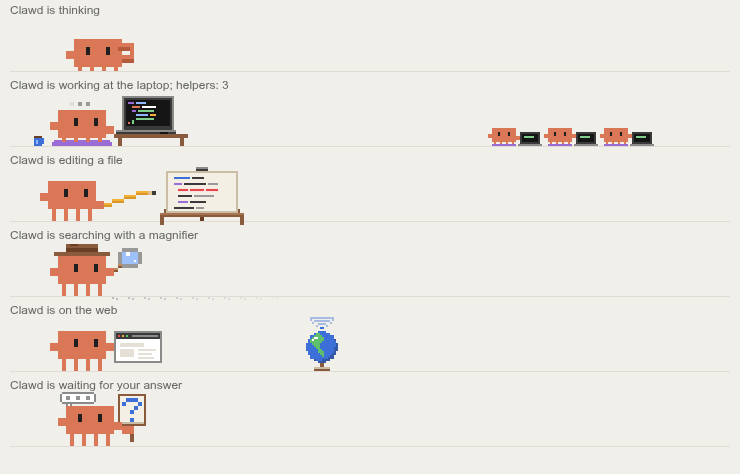
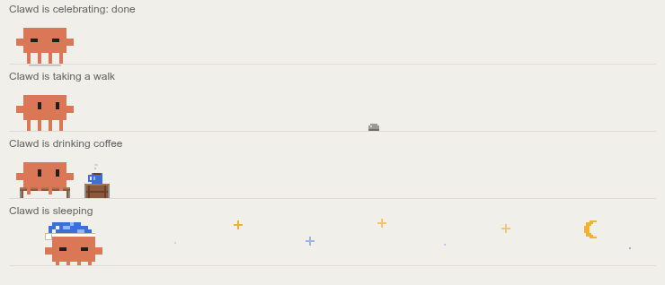
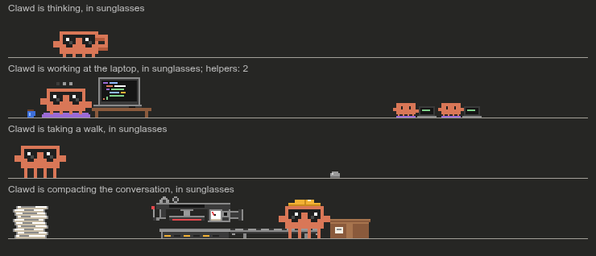
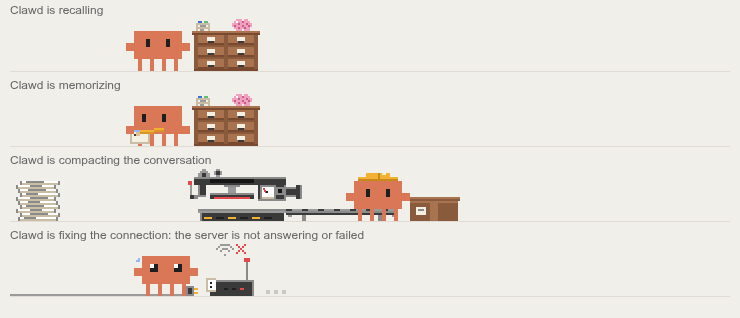

# clawd-buddy

A pixel Clawd that lives in the band above the prompt in Claude Code and acts out what your session is doing:
thinking, working at a laptop, editing a file, searching, browsing, waiting for your answer, compacting the
conversation, taking a walk when idle, and falling asleep when you leave.

It is a Claude Code mod built on **function hooks** (early access): no server, no network, no settings to fill in.

> Unofficial fan-made mod, not affiliated with or endorsed by Anthropic. Claude and Clawd are trademarks of Anthropic.









## Scenes

| Scene | When |
| --- | --- |
| Thinking | the model is thinking or waiting for the server to start answering |
| Working | a turn is running (laptop; now and then a sip of coffee) |
| Editing | `Edit` / `Write` / `NotebookEdit`, MCP tools named `create_*`, `update_*`, `write_*`... |
| Searching | `Read` / `Grep` / `Glob`, shell `grep`, `rg`, `find`, `cat`..., MCP tools named `search_*`, `get_*`, `list_*`... |
| On the web | `WebSearch` / `WebFetch`, browser and scraping MCP servers, shell `curl`, `wget`, `ssh`... |
| Question | `AskUserQuestion`, `ExitPlanMode` — Clawd waits for your answer |
| Recalling / memorizing | reading or writing Claude Code's memory folder (`~/.claude/projects/<project>/memory`), any MCP server or tool whose name has the word `memory`, `memories`, `mem0`, `remember` or `recall`, the engine's own memory notices |
| Compacting | the conversation is being compacted (a 36-second story with a press) |
| Offline | the server has not started answering for 90 s, the spinner says it is retrying, or a turn ended with an API error |
| Celebrating | for 4 s after a turn ends with an answer |
| Walk and coffee | while idle: a 24 s walk and 16 s of coffee, in a loop |
| Sleeping | after 20 minutes of idling |
| Sunglasses | in ultra mode, on top of any scene |
| Mini-helpers | one small Clawd per subagent the main session runs (up to 4, then a `+N` badge); a finished agent gets a green check mark and dissolves |

Scene changes are smooth: Clawd stays where he is and starts the new activity on that spot (mirrored near an edge),
the old scene fades out and the new one fades in; a scene holds for at least 2 s, so there is no flicker.

## Requirements and limits

- **Claude Code desktop app.** Clawd is an animated SVG. The band above the prompt exists on the terminal and on the
  desktop surface, but only the desktop draws `Svg`, so in the terminal the mod draws nothing (and does not get in
  the way).
- **Function hooks are early access.** The API may change between Claude Code releases. Tested with Claude Code
  2.1.292.
- Ultra-mode sunglasses rely on the engine's `ultra_effort_enter` / `ultra_effort_exit` transcript insertions; if a
  release renames them, the sunglasses simply stop appearing.
- The mod plays well with other mods that draw in the same band: it always calls `next(e)` and draws Clawd above
  whatever the rest of the chain drew.

## Install

Clone the repository anywhere, then point Claude Code at the folder and turn function hooks on.

**One session from the terminal:**

```sh
CLAUDE_CODE_ENABLE_FUNCTION_HOOKS=1 claude --plugin-dir /path/to/clawd-buddy-mod
```

**Every session, the desktop app included** — add both variables to the `env` block of `~/.claude/settings.json`
(`CLAUDE_CODE_PLUGIN_DIRS` takes one or more absolute paths, separated by the platform's path-list separator):

```json
{
  "env": {
    "CLAUDE_CODE_ENABLE_FUNCTION_HOOKS": "1",
    "CLAUDE_CODE_PLUGIN_DIRS": "/path/to/clawd-buddy-mod"
  }
}
```

The environment is read when a session's process starts, so Clawd appears in new or restarted sessions. A
long-lived desktop session does not watch the folder for edits unless `CLAUDE_CODE_PLUGIN_DIR_WATCH=1` is set the
same way.

## Development

```sh
claude plugin validate --strict .   # manifest and hooks module, the way the engine reads them
claude plugin test .                 # runs hooks/*.test.ts(x) against the engine
```

The TypeScript declarations of the hooks API are **not** in this repository: Claude Code writes them for the exact
build you run into `.claude-plugin/types/` every time it loads the mod from a folder you own (`--plugin-dir` or
`CLAUDE_CODE_PLUGIN_DIRS`), and `tsconfig.json` extends the `tsconfig.json` it writes there. To type-check:

```sh
# load the mod once so the engine writes .claude-plugin/types/
CLAUDE_CODE_ENABLE_FUNCTION_HOOKS=1 claude -p --plugin-dir . "/context" > /dev/null
npx -p typescript tsc -p .
```

Layout:

- `hooks/register.tsx` — the hooks: what the session is doing → Clawd's state; draws the band.
- `hooks/buddy.ts` — picks the scene, smooth transitions, helpers.
- `hooks/clawd/*.ts` — the scenes themselves (SVG + SMIL animation, no CSS, no scripts); `meta.ts` holds where Clawd
  stands at every moment of every scene, measured from rendered frames.
- `types/index.d.ts` — the mod's state contract.

## License

MIT, see [LICENSE](LICENSE).

---

## Русский

Пиксельный Клод (Clawd) живёт в полосе над полем ввода Claude Code и показывает, чем занята сессия: думает,
работает за ноутбуком, правит файл, ищет с лупой, сидит в интернете, ждёт вашего ответа, сжимает переписку, гуляет и
пьёт кофе в простое, засыпает, когда вас долго нет.

Это мод Claude Code на **function hooks** (ранний доступ): без сервера, без сети, без настроек.

> Неофициальный фанатский мод, не связан с Anthropic и не одобрен ею. Claude и Clawd — товарные знаки Anthropic.

### Сцены

- **Думает** — модель размышляет или ждёт начала ответа сервера.
- **Работает** — идёт ход (ноутбук; иногда глоток кофе).
- **Правит** — `Edit` / `Write` / `NotebookEdit`, MCP-инструменты `create_*`, `update_*`, `write_*`…
- **Ищет** — `Read` / `Grep` / `Glob`, в терминале `grep`, `rg`, `find`, `cat`…, MCP-инструменты `search_*`, `get_*`, `list_*`…
- **Интернет** — `WebSearch` / `WebFetch`, браузерные и парсящие MCP-серверы, `curl`, `wget`, `ssh`…
- **Вопрос** — `AskUserQuestion`, `ExitPlanMode`: Клод ждёт вашего ответа.
- **Вспоминает / запоминает** — чтение и запись папки памяти Claude Code (`~/.claude/projects/<проект>/memory`),
  любой MCP-сервер или инструмент со словом `memory`, `memories`, `mem0`, `remember` или `recall` в имени,
  уведомления движка о памяти.
- **Компакт** — идёт сжатие переписки (сюжет на 36 секунд с прессом).
- **Нет связи** — сервер не начал отвечать за 90 с, строка хода пишет про повтор, или ход оборвался ошибкой API.
- **Праздник** — 4 с после хода, закончившегося ответом.
- **Прогулка и кофе** — в простое: 24 с прогулки и 16 с кофе по кругу.
- **Сон** — после 20 минут простоя.
- **Очки** — в режиме ultra, поверх любой сцены.
- **Мини-помощники** — по маленькому Клоду на каждого сабагента основной сессии (до 4, дальше бейдж `+N`);
  закончивший агент получает зелёную галочку и растворяется.

Сцены сменяются плавно: Клод остаётся на месте и начинает новое дело там, где стоит (у края — зеркально), старая
сцена тает, новая проявляется; сцена держится не меньше 2 с, без мельтешения.

### Требования и ограничения

- **Десктоп-приложение Claude Code.** Клод — анимированный SVG. Полоса над вводом есть в терминале и на десктопе,
  но `Svg` рисует только десктоп; в терминале мод ничего не рисует и не мешает.
- **Function hooks — ранний доступ**, API может меняться между версиями. Проверено на Claude Code 2.1.292.
- Очки в режиме ultra завязаны на вставки движка `ultra_effort_enter` / `ultra_effort_exit`; если их переименуют,
  очки просто перестанут появляться.
- Мод уживается с другими модами в той же полосе: всегда вызывает `next(e)` и рисует Клода над тем, что нарисовала
  остальная цепочка.

### Установка

Склонируйте репозиторий куда угодно и укажите Claude Code на папку, включив function hooks.

Одна сессия из терминала:

```sh
CLAUDE_CODE_ENABLE_FUNCTION_HOOKS=1 claude --plugin-dir /path/to/clawd-buddy-mod
```

Все сессии, включая десктоп, — обе переменные в блок `env` файла `~/.claude/settings.json`:

```json
{
  "env": {
    "CLAUDE_CODE_ENABLE_FUNCTION_HOOKS": "1",
    "CLAUDE_CODE_PLUGIN_DIRS": "/path/to/clawd-buddy-mod"
  }
}
```

Окружение читается при старте процесса сессии, поэтому Клод появится в новых или перезапущенных сессиях. Долгоживущая
десктоп-сессия не следит за правками в папке, если так же не задан `CLAUDE_CODE_PLUGIN_DIR_WATCH=1`.

### Разработка

Проверки — `claude plugin validate --strict .` и `claude plugin test .`. Типы API движка в репозиторий не входят:
Claude Code сам пишет их под свою версию в `.claude-plugin/types/` при каждой загрузке мода из вашей папки. Чтобы
проверить типы, загрузите мод один раз (`CLAUDE_CODE_ENABLE_FUNCTION_HOOKS=1 claude -p --plugin-dir . "/context"`)
и запустите `tsc -p .`.

Лицензия — MIT, см. [LICENSE](LICENSE).
